# Refashion IA

**Aplicación de Modelos de Difusión y Técnicas de Visión por Computadora en un Sistema de
Prototipado para Uniformes Corporativos**

Trabajo de graduación, modalidad Trabajo Profesional. Ingeniería en Ciencia de la Computación y
Tecnologías de la Información, Universidad del Valle de Guatemala, 2026.

Aplicación desplegada: https://refashion-tg.vercel.app/

## Descripción

Una empresa pequeña que produce uniformes corporativos necesita mostrarle al cliente cómo se
verá la prenda antes de fabricarla. Esa propuesta suele armarse a mano en un editor de imágenes,
y cada cambio que pide el cliente vuelve a pasar por el diseñador.

Refashion IA es una herramienta interna que acorta ese ciclo. Organiza el trabajo por cliente,
proyecto y diseño, y sobre una prenda base permite:

- **Componer logotipos** como capas que se mueven, escalan y rotan, con quitado de fondo en el
  navegador.
- **Editar la prenda** de cuatro formas: recolorearla con el color exacto elegido, completar una
  zona marcada (FLUX.1 Fill), dibujar algo nuevo dentro de una zona (FLUX.1 dev) o modificarla con
  una instrucción en texto (FLUX.1 Kontext).
- **Presentarla** plana, sobre la foto de una persona con prueba virtual (P-Image Try-On) o sobre
  una persona generada (FLUX.1 dev).

Cada paso queda en un historial navegable, y cada generación guarda el modelo, la semilla, la
instrucción y el costo que facturó el proveedor.

La aplicación es un monolito Next.js desplegado en Vercel. Supabase guarda la base de datos y la
autenticación, Cloudflare R2 las imágenes, y Runware ejecuta los modelos generativos. Solo la
API interna tiene las credenciales de esos servicios. El detalle técnico (arquitectura, base de
datos, permisos, convenciones y decisiones) está en [src/README.md](src/README.md).

## Tecnologías utilizadas

- **Next.js 16** (App Router), **React 19** y **TypeScript**
- **Supabase**: PostgreSQL, autenticación y Row Level Security
- **Cloudflare R2**, con el SDK de S3
- **Runware** para la inferencia de FLUX.1 Fill, FLUX.1 dev, FLUX.1 Kontext y P-Image Try-On
- **Konva** / **react-konva** para el lienzo de composición y de máscaras
- **Tailwind CSS v4** (tokens de diseño) y CSS Modules
- **Zod 4** para validar la API
- **Vercel** para el despliegue
- **Python** para los scripts de experimentos de `src/herramientas/`
- **Lighthouse** para la evaluación de la interfaz

## Requisitos previos

- **Node.js 20.9 o superior** y npm
- **Git**
- Un proyecto de **Supabase** y un bucket de **Cloudflare R2**
- Opcional: una llave de **Runware**. Sin ella, la aplicación funciona contra un simulador que
  devuelve imágenes de prueba y no cobra.

## Instalación

```bash
git clone https://github.com/GraduacionesUVG/2026-221007-chuy-morales-ricardo-andres.git
cd 2026-221007-chuy-morales-ricardo-andres/src
npm install
cp .env.example .env.local   # y llenar los valores
npm run dev
```

La aplicación queda en http://localhost:3000. Sin sesión, cualquier página redirige a `/login`.

Antes del primer arranque hay que preparar los servicios: crear el proyecto de Supabase, correr
las migraciones de `src/docs/` en orden, crear el primer usuario admin y configurar el bucket de
R2 con su política CORS. Los pasos completos, la tabla de variables de entorno y el despliegue en
Vercel están en la sección [Configuración de src/README.md](src/README.md#configuración).

Para generar la versión de producción:

```bash
npm run build
npm start
```

## Capturas

Las 17 capturas están en [`/capturas`](capturas/), en el orden en que se usa la aplicación.
Recorren un mismo diseño de principio a fin: una polo color crema que se vuelve una camisa
verde de manga larga con el emblema del cliente.

### Acceso y organización

| | |
|---|---|
| 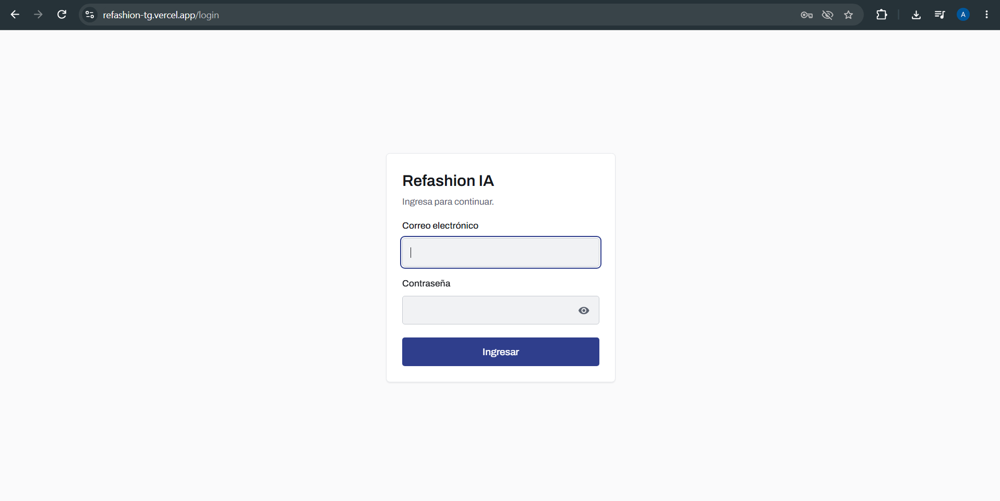 | 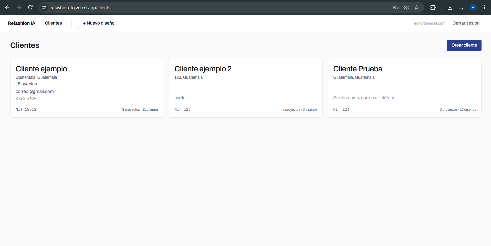 |
| 1. Inicio de sesión. No hay registro público: los usuarios los crea un admin | 2. Lista de clientes, con sus proyectos y diseños |
| 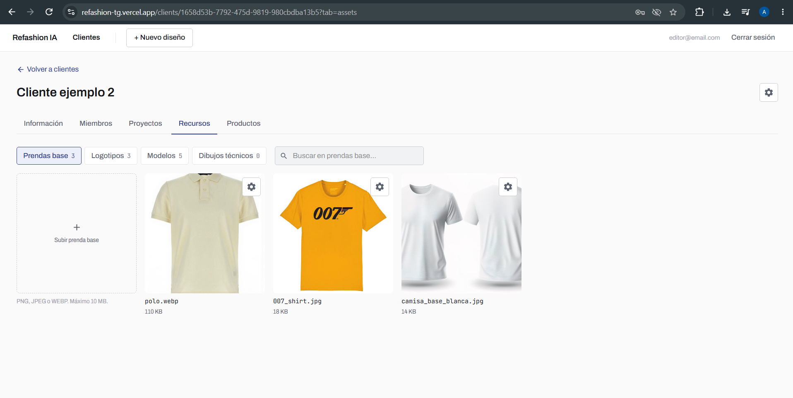 | 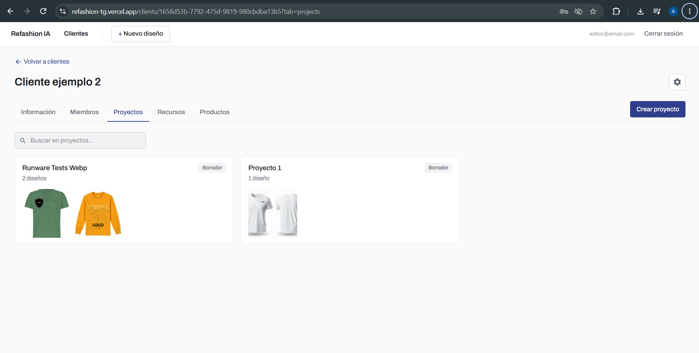 |
| 3. Recursos del cliente: prendas base, logotipos, modelos y dibujos técnicos | 4. Proyectos del cliente, cada uno con sus diseños |

### Edición de la prenda

| | |
|---|---|
| 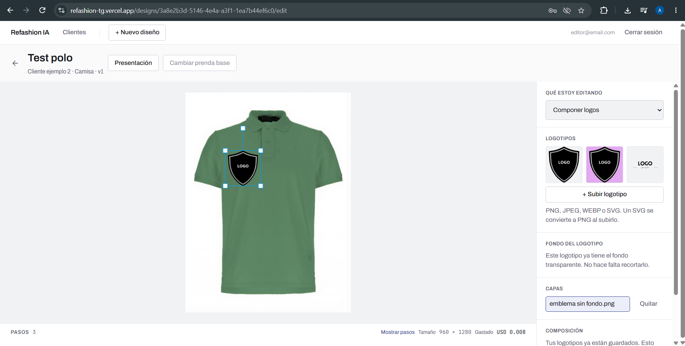 | 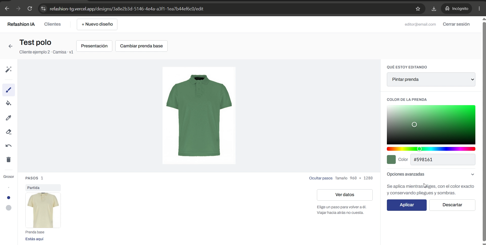 |
| 5. Componer logotipos: el emblema es una capa que se mueve, escala y rota | 6. Pintar prenda: recoloreado con el color exacto elegido, sin IA |
| 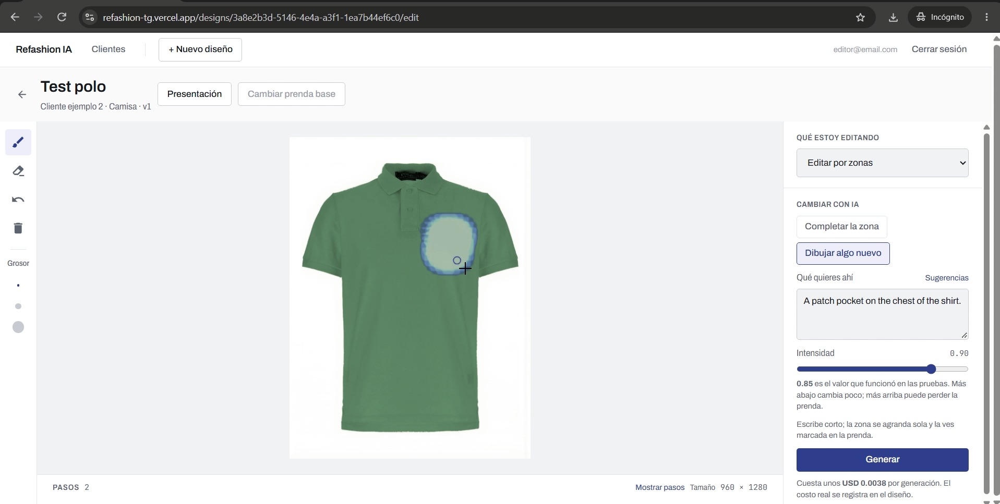 | 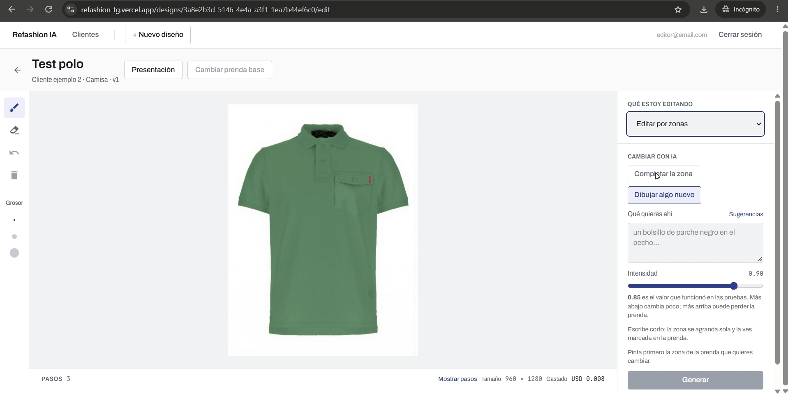 |
| 7. Dibujar algo nuevo (FLUX.1 dev): se marca la zona y se describe qué va ahí | 8. Resultado: un bolsillo de parche en el pecho |
| 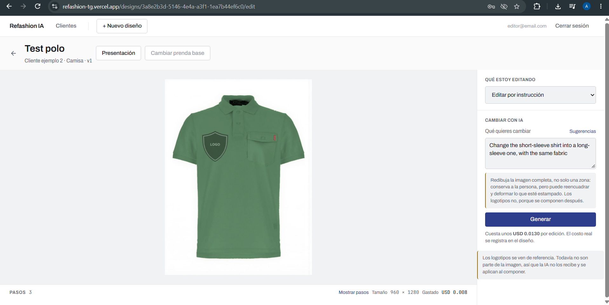 | 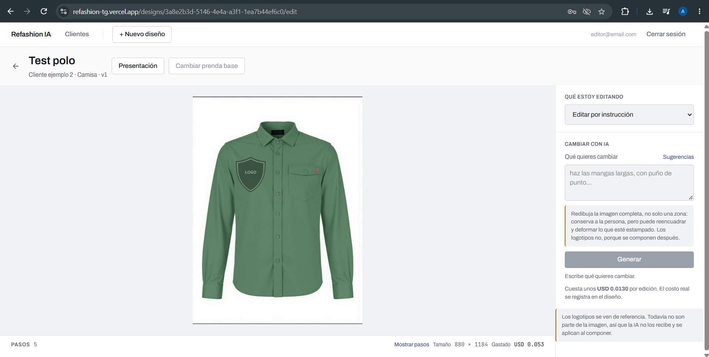 |
| 9. Editar por instrucción (FLUX.1 Kontext): pasar de manga corta a manga larga | 10. Resultado: camisa de manga larga con la misma tela. El logotipo no pasa por la IA |

### Presentación

| | |
|---|---|
| 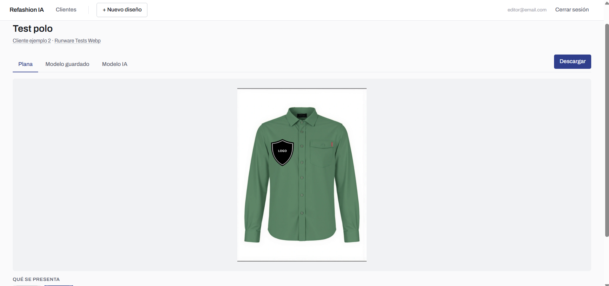 | 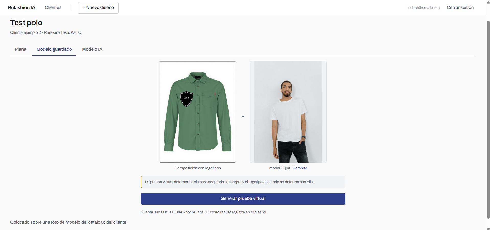 |
| 11. Presentación plana, con los logotipos compuestos | 12. Prueba virtual (P-Image Try-On) sobre una foto del catálogo del cliente |
| 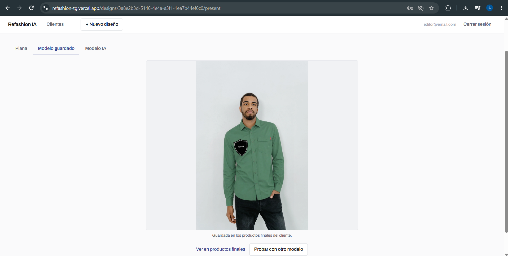 | 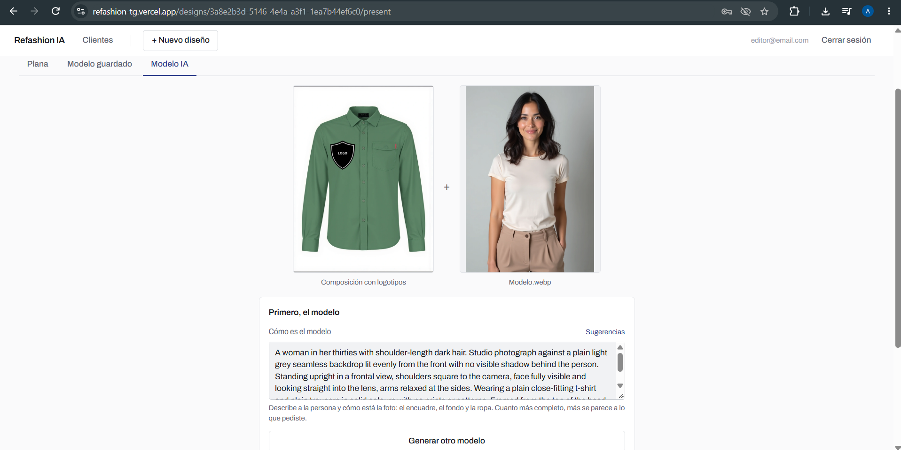 |
| 13. Resultado de la prueba virtual | 14. Modelo generado por IA (FLUX.1 dev) a partir de una descripción |
| 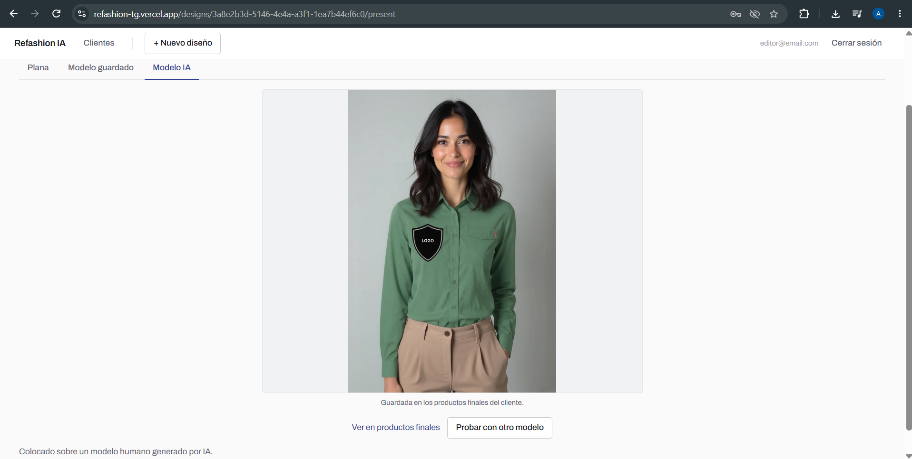 | |
| 15. Prueba virtual sobre el modelo generado | |

### Seguimiento

| | |
|---|---|
| 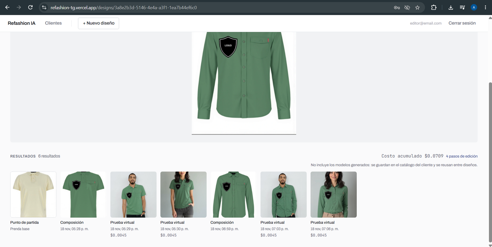 | 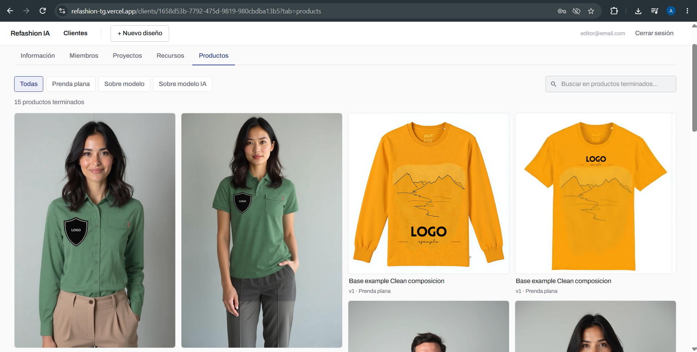 |
| 16. Resultados del diseño, con el costo de cada generación y el costo acumulado | 17. Productos terminados del cliente, filtrables por prenda plana, sobre modelo y sobre modelo IA |

## Demo

Video demostrativo: [demo/demo.mp4](demo/demo.mp4)

## Documentación

- Informe final: [docs/informe_final.pdf](docs/informe_final.pdf)
- Documentación técnica del sistema: [src/README.md](src/README.md)
- Scripts y resultados de los experimentos que sostienen el informe:
  [src/herramientas/](src/herramientas/)
- Informes de Lighthouse: [src/lighthouse-reports/](src/lighthouse-reports/)

## Consentimiento firmado

[docs/consentimiento_firmado.pdf](docs/consentimiento_firmado.pdf)

## Autor

**Ricardo Andrés Chuy Morales**, carné 221007

Asesor: Ing. Erick Francisco Marroquín Rodríguez

## Licencia

Copyright (c) 2026 Ricardo Andrés Chuy Morales.

El código se distribuye bajo la [PolyForm Noncommercial License 1.0.0](LICENSE): se puede leer,
estudiar y usar con fines no comerciales. Cualquier uso comercial requiere autorización del
autor.

Los modelos FLUX.1 se usan bajo los términos de Black Forest Labs. FLUX.1 dev tiene licencia no
comercial, y este trabajo es académico.
